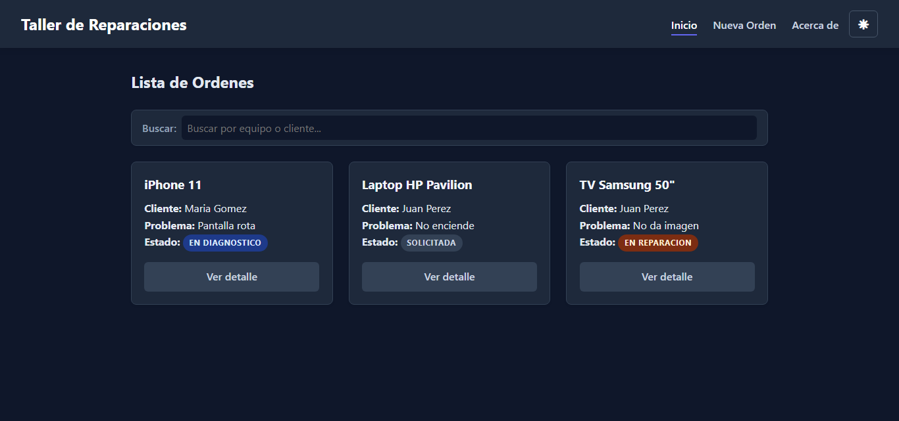

<h1 align="center">Taller de Reparaciones - 2do Parcial</h1>

  Proyecto práctico para la asignatura <b>Programación Web</b> (Ingeniería Informática, 3er año).

---

<h2>Descripción</h2>

Aplicación web para gestionar las órdenes de un taller de reparaciones de equipos electrónicos. Permite registrar clientes, crear órdenes, gestionar presupuestos, validar transiciones de estado y mantener un historial de eventos. Toda la información se guarda en PocketBase y el frontend consume la API con <code>fetch</code> puro.

<h2>Tecnologías</h2>
<ul>
  <li><b>Cliente:</b> React + Vite (JavaScript).</li>
  <li><b>Servidor:</b> PocketBase (v0.41.1) con migraciones y hooks.</li>
  <li><b>Enrutamiento:</b> React Router con rutas anidadas y <code>Outlet</code>.</li>
  <li><b>Estilos:</b> CSS puro con variables, modo oscuro y animaciones.</li>
</ul>

<h2>Requisitos previos</h2>
<ul>
  <li>Node.js (v18 o superior).</li>
  <li>PocketBase (v0.41.1 o superior).</li>
</ul>

<h2>Cómo levantar el proyecto desde cero</h2>

<h3>1. Clonar el repositorio</h3>
<pre><code>git clone https://github.com/Yosbiel/Yosbiel-A-Taller-Reparaciones-2do-Parcial.git
cd taller-reparaciones</code></pre>

<h3>2. Iniciar el servidor (PocketBase)</h3>
<pre><code>cd servidor
./pocketbase serve</code></pre>

Esto iniciará PocketBase en <code>http://127.0.0.1:8090</code>.

<h3>3. Iniciar el cliente (React)</h3>
<pre><code>cd cliente
npm install
npm run dev</code></pre>

Esto iniciará Vite y generará un enlace (generalmente <code>http://localhost:5173</code>). Cópialo en tu navegador para ver la aplicación.

<h3>4. Arranque rápido (opcional para Windows)</h3>

Si estás en Windows, puedes usar los archivos <code>.ps1</code> incluidos en las carpetas <code>cliente/</code> y <code>servidor/</code>.

<ul>
  <li>Haz clic derecho en <code>servidor/start.ps1</code> y selecciona "Ejecutar con PowerShell" para levantar PocketBase.</li>
  <li>Luego haz lo mismo con <code>cliente/start.ps1</code>. Este generará el enlace de Vite en la terminal; cópialo y pégalo en tu navegador.</li>
</ul>

<h2>Datos de prueba</h2>

El proyecto incluye datos de prueba pre-cargados (2 clientes y 3 órdenes en distintas etapas). Si necesitas recrearlos, puedes usar el panel de administración de PocketBase (<code>http://127.0.0.1:8090/_/</code>) o insertarlos mediante la API.

<h2>Funcionalidades implementadas</h2>
<ul>
  <li>Registro de órdenes con fotos (hasta 3 imágenes).</li>
  <li>Flujo de estados validado por hooks del servidor: <code>solicitada</code> -> <code>en_diagnostico</code> -> <code>presupuestada</code> -> <code>aprobada</code> -> <code>en_reparacion</code> -> <code>lista</code> -> <code>entregada</code>.</li>
  <li>Registro automático de eventos en el historial (con fecha).</li>
  <li>Cálculo del total del presupuesto (mano de obra + piezas) en el cliente con <code>useMemo</code>.</li>
  <li>Reglas de seguridad: no se pueden borrar órdenes, no se pueden editar/borrar eventos y no se pueden saltar etapas.</li>
  <li>Modo oscuro/claro con persistencia en <code>localStorage</code>.</li>
  <li>Píldoras de estado con colores según la etapa.</li>
  <li>Búsqueda y orden alfabético en la lista de órdenes.</li>
</ul>

<h2>Estructura del proyecto</h2>
<ul>
  <li><code>cliente/</code>: Código de React (Vite).</li>
  <li><code>servidor/</code>: Configuración de PocketBase, migraciones y hooks.</li>
  <li><code>capturas/</code>: Capturas de pantalla del proyecto.</li>
</ul>

---

<h2>Capturas de Pantalla</h2>

<table align="center">
  <tr>
    <td align="center"><b>Lista de Órdenes (Claro)</b> </td>
    <td align="center"><b>Lista de Órdenes (Oscuro)</b> </td>
  </tr>
  <tr>
    <td align="center"><b>Nueva Orden</b> </td>
    <td align="center"><b>Detalle de Orden</b> </td>
  </tr>
  <tr>
    <td align="center" colspan="2"><b>Acerca de</b> </td>
  </tr>
</table>

---

<i>Desarrollado por Yosbiel Alejandro Díaz Cala.</i>

