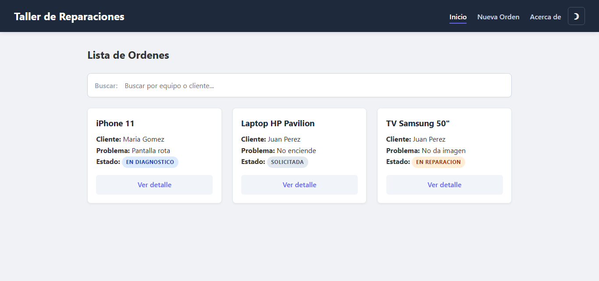
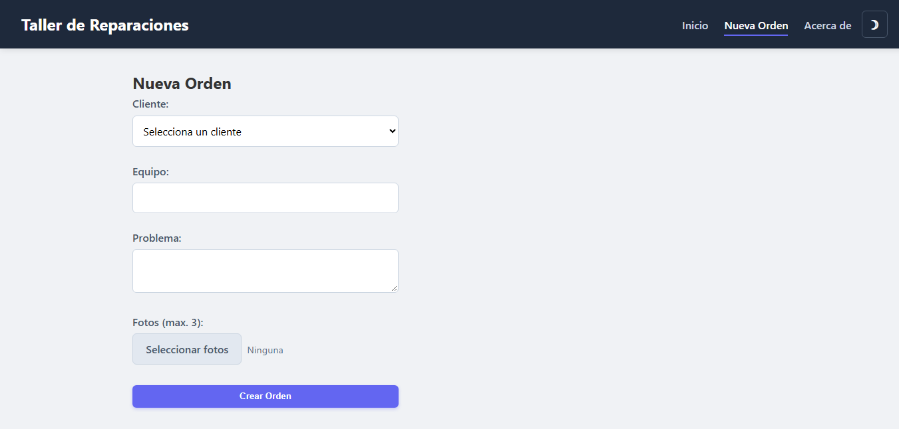
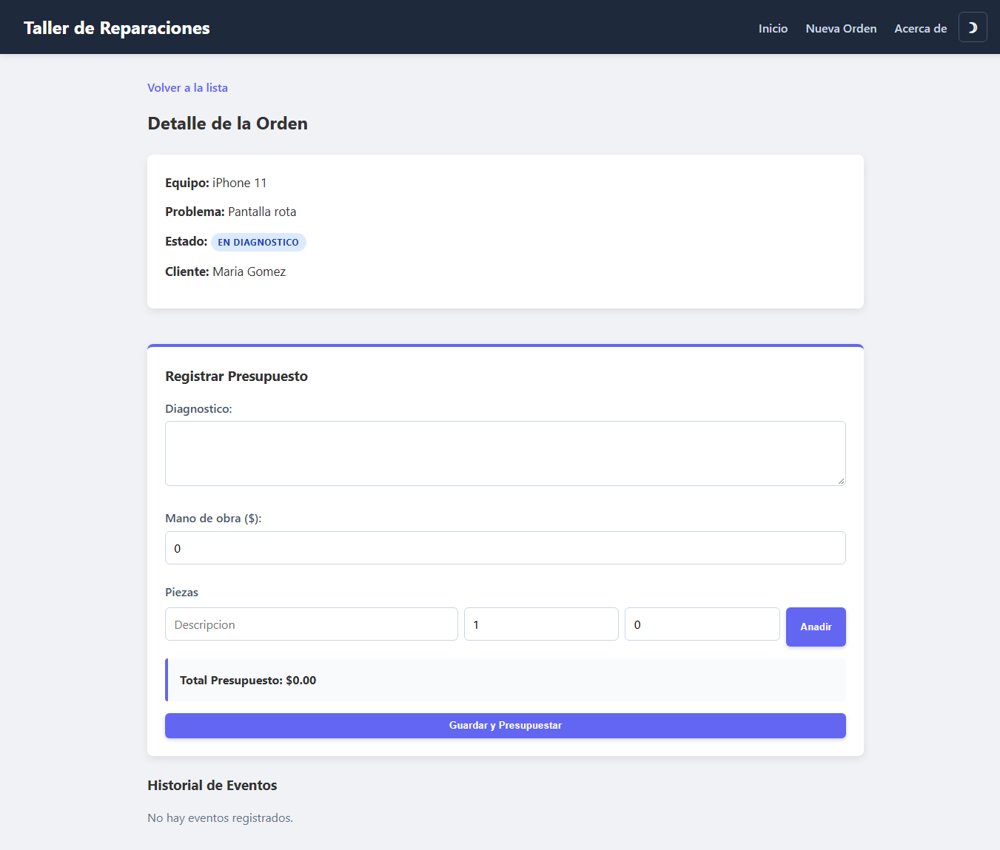
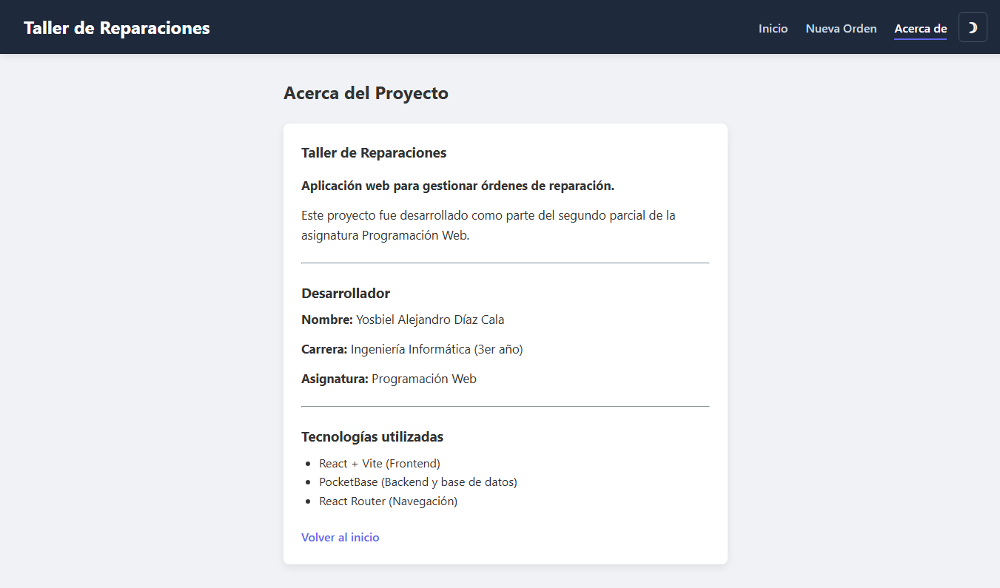

# Taller de Reparaciones - 2do Parcial

**Estudiante:** Yosbiel Alejandro Díaz Cala  
**Carrera:** Ingeniería Informática (3er año)  
**Asignatura:** Programación Web

Aplicación web para gestionar las órdenes de un taller de reparaciones de equipos electrónicos.

## Tecnologías
- **Cliente:** React + Vite (JavaScript)
- **Servidor:** PocketBase (v0.41.1)

## Requisitos previos
- Node.js (v18 o superior)
- PocketBase (v0.41.1 o superior)

## Cómo levantar el proyecto desde cero

### 1. Clonar el repositorio
git clone https://github.com/Yosbiel/Yosbiel-A-Taller-Reparaciones-2do-Parcial.git
cd taller-reparaciones

### 2. Iniciar el servidor (PocketBase)
cd servidor
./pocketbase serve
Esto iniciará PocketBase en http://127.0.0.1:8090

### 3. Iniciar el cliente (React)
Abre otra terminal y ejecuta:
cd cliente
npm install
npm run dev
Esto iniciará Vite en http://localhost:5173

## Datos de prueba
El proyecto incluye datos de prueba pre-cargados (2 clientes y 3 órdenes en distintas etapas). Si necesitas recrearlos, puedes usar el panel de administración de PocketBase (http://127.0.0.1:8090/_/) o insertarlos mediante la API.

## Funcionalidades implementadas
- Registro de órdenes con fotos (hasta 3 imágenes).
- Flujo de estados validado por hooks del servidor: solicitada -> en_diagnostico -> presupuestada -> aprobada -> en_reparacion -> lista -> entregada.
- Registro automático de eventos en el historial (fecha incluida).
- Cálculo del total del presupuesto (mano de obra + piezas) en el cliente con useMemo.
- Reglas de seguridad: no se pueden borrar órdenes, no se pueden editar/borrar eventos, y no se pueden saltar etapas.
- Modo oscuro/claro con persistencia.
- Píldoras de estado con colores.
- Búsqueda y orden alfabético en la lista de órdenes.

## Estructura del proyecto
- cliente/: Código de React (Vite).
- servidor/: Configuración de PocketBase, migraciones y hooks.
- capturas/: Capturas de pantalla del proyecto.

---

## Capturas de Pantalla

<table align="center">
  <tr>
    <td align="center"><b>Lista de Ordenes (Claro)</b> </td>
    <td align="center"><b>Lista de Ordenes (Oscuro)</b> </td>
  </tr>
  <tr>
    <td align="center"><b>Nueva Orden</b> </td>
    <td align="center"><b>Detalle de Orden</b> </td>
  </tr>
  <tr>
    <td align="center" colspan="2"><b>Acerca de</b> </td>
  </tr>
</table>

---

<i>Desarrollado por Yosbiel Alejandro Díaz Cala.</i>

